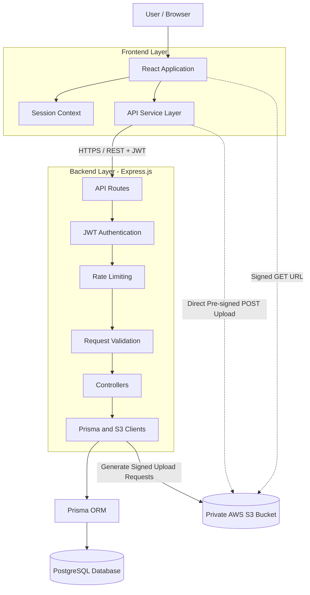
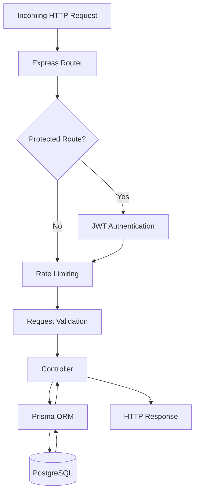
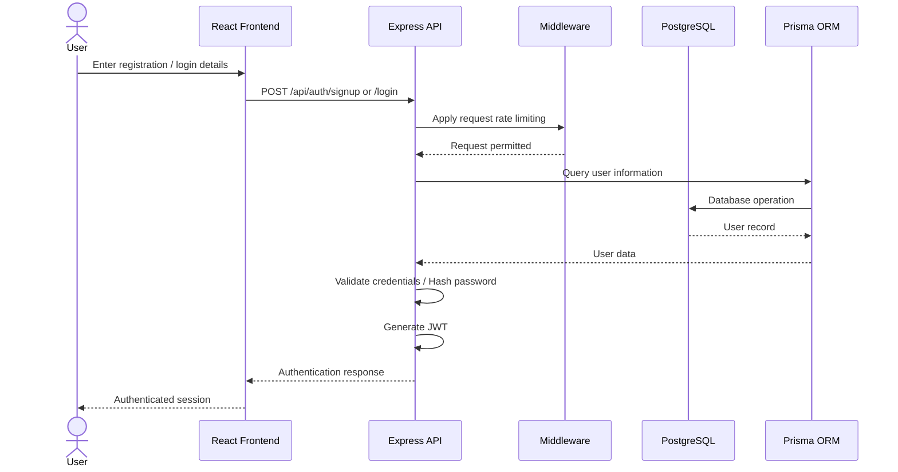
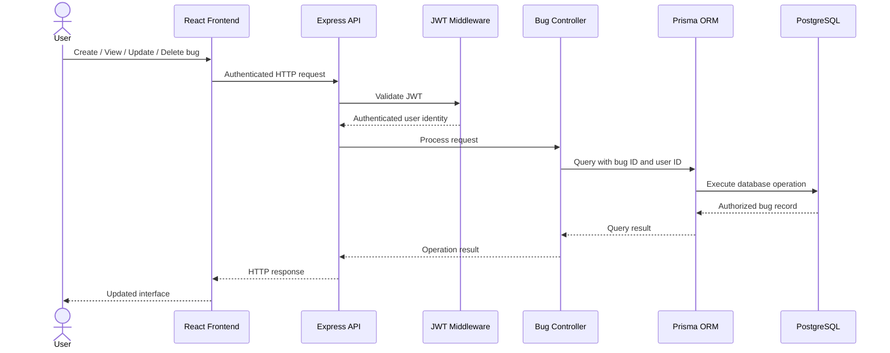

# Bug Tracker Lite

A full-stack issue tracking application built as part of the **Elovient Full Stack Developer Evaluation**.

Bug Tracker Lite enables authenticated users to create, manage, filter, and track software bugs, with secure screenshot uploads powered by AWS S3.

The application follows a **Turborepo monorepo architecture**, consisting of a React and Tailwind CSS frontend, an Express.js backend, and a PostgreSQL database managed through Prisma ORM.

It also includes Docker-based containerization and GitHub Actions workflows for continuous integration, container image publishing, and EC2 deployment.

---

## Table of Contents

- [Overview](#overview)
- [Key Features](#key-features)
- [Technology Stack](#technology-stack)
- [System Architecture](#system-architecture)
- [Application Architecture](#application-architecture)
- [Monorepo Structure](#monorepo-structure)
- [Core Workflows](#core-workflows)
  - [Authentication Flow](#1-authentication-flow)
  - [Bug Management Flow](#2-bug-management-flow)
  - [Screenshot Upload Flow](#3-screenshot-upload-flow)
- [Database Design](#database-design)
- [API Documentation](#api-documentation)
- [Docker Architecture](#docker-architecture)
- [CI/CD Pipeline](#cicd-pipeline)
- [Production Deployment Architecture](#production-deployment-architecture)
- [Security Considerations](#security-considerations)
- [Local Development Setup](#local-development-setup)
- [Environment Variables](#environment-variables)
- [Additional Assignment Deliverables](#additional-assignment-deliverables)
- [Deployment Status](#deployment-status)

---

## Overview

Bug Tracker Lite provides a centralized platform for reporting and managing software issues.

Users can register, authenticate, create bug reports, assign severity and status, attach screenshots, and manage their own bug records.

The application is designed around four primary engineering principles:

1. **Modularity:** Separate frontend, backend, database, and shared responsibilities through a Turborepo monorepo.
2. **Security:** Protect application resources using JWT authentication, bcrypt password hashing, rate limiting, and server-side ownership verification.
3. **Scalability:** Separate application services from database and file storage infrastructure.
4. **Deployment Automation:** Use Docker and GitHub Actions to automate builds, container image publishing, and deployment workflows.

---

## Key Features

### Authentication and Authorization

- User registration and login.
- Password hashing using bcrypt.
- JWT-based authentication.
- Per-IP rate limiting.
- Protected API endpoints.
- Server-side ownership verification for every bug operation.

### Bug Management

- Create, list, view, update, and delete bugs.
- Filter bugs by status.
- User-specific bug records.
- Three severity levels:
  - `low`
  - `med`
  - `high`
- Three status values:
  - `open`
  - `in-progress`
  - `closed`

### Screenshot Management

- Direct browser-to-S3 screenshot uploads.
- Short-lived pre-signed POST requests.
- Private S3 object storage.
- File type and 5 MB size validation.
- Short-lived signed GET URLs for image viewing.
- Automatic deletion of associated S3 objects when bugs are deleted.

### Database Management

- PostgreSQL as the primary relational database.
- Prisma ORM for database access.
- Version-controlled database schema and SQL migrations.
- User ownership relationships.
- Enumerated severity and status values.
- Database indexes for efficient querying.

### DevOps and Deployment

- Turborepo monorepo architecture.
- Docker and Docker Compose.
- GitHub Actions CI workflows.
- Automated Docker image builds.
- GitHub Container Registry (GHCR) publishing.
- EC2 deployment workflow through SSH.

---

## Technology Stack

| Layer | Technologies |
|---|---|
| Frontend | React.js, Tailwind CSS |
| Backend | Node.js, Express.js |
| Database | PostgreSQL |
| ORM | Prisma ORM |
| Authentication | JWT, bcrypt |
| File Storage | AWS S3 |
| Monorepo | Turborepo, npm Workspaces |
| Containerization | Docker, Docker Compose |
| CI/CD | GitHub Actions |
| Container Registry | GitHub Container Registry |
| Deployment | AWS EC2 |
| Development Tools | Git, GitHub, npm |

---

## System Architecture

The application follows a layered client-server architecture with a separate database and object storage layer.

The React frontend communicates with the Express API through REST endpoints. The backend handles authentication, authorization, request validation, business logic, and database operations.

Prisma ORM provides the database access layer between Express.js and PostgreSQL.

AWS S3 is used independently for private screenshot storage, allowing browsers to upload files directly without routing file contents through the backend.

### High-Level Architecture



### Architecture Components

| Component | Responsibility |
|---|---|
| React Application | Handles user interactions and interface rendering. |
| Session Context | Maintains frontend authentication state. |
| API Service Layer | Centralizes communication with backend endpoints. |
| Express Routes | Defines HTTP endpoints and request routing. |
| JWT Middleware | Authenticates incoming protected requests. |
| Rate Limiting Middleware | Restricts excessive requests based on client IP. |
| Validation Utilities | Validates incoming request data. |
| Controllers | Handle HTTP requests and coordinate operations. |
| Prisma Client | Provides type-safe database access through Prisma ORM. |
| PostgreSQL | Stores users and bug records. |
| AWS S3 | Stores private screenshot objects. |

---

## Application Architecture

The codebase follows a separation-of-concerns approach, keeping HTTP handling, business operations, validation, database access, and frontend responsibilities logically separated.

### Backend Request Lifecycle



**Routes:** Define application endpoints and connect requests to the appropriate middleware and controllers.

**Middleware:** Handles shared request processing, including JWT authentication, rate limiting, and error handling.

**Controllers:** Coordinate application operations and generate HTTP responses.

**Configuration:** Initializes reusable Prisma and AWS S3 clients.

**Prisma ORM:** Handles communication between the application and PostgreSQL.

### Frontend Architecture

The frontend separates application routing, session state, reusable components, page-level components, and API communication.

```text
React Application
       |
       v
Application Router
       |
       +------> Session Context
       |
       v
Pages
       |
       v
Reusable Components
       |
       v
API Service Layer
       |
       v
Express REST API
```

This structure improves maintainability and makes it easier to extend application functionality without tightly coupling UI components to backend implementation details.

---

## Monorepo Structure

The repository uses Turborepo and npm Workspaces to manage frontend and backend applications from a single repository.

```text
bug-tracker-lite/
│
├── apps/
│   │
│   ├── api/
│   │   ├── prisma/
│   │   │   ├── migrations/
│   │   │   └── schema.prisma
│   │   │
│   │   ├── src/
│   │   │   ├── config/
│   │   │   ├── controllers/
│   │   │   ├── middleware/
│   │   │   ├── routes/
│   │   │   ├── services/
│   │   │   └── utils/
│   │   │
│   │   ├── .env.example
│   │   └── package.json
│   │
│   └── web/
│       ├── src/
│       │   ├── app/
│       │   ├── components/
│       │   ├── pages/
│       │   └── services/
│       │
│       ├── .env.example
│       └── package.json
│
├── packages/
│
├── docs/
│   ├── production-monitoring-proposal.md
│   └── paint-erp-architecture.svg
│
├── .github/
│   └── workflows/
│
├── docker-compose.yml
├── docker-compose.prod.yml
├── package.json
├── turbo.json
├── NOTES.md
└── README.md
```

**Note:** This is a logical representation of the repository structure. The exact Docker and workflow filenames should match the actual repository.

---

## Core Workflows

### 1. Authentication Flow

The application uses JWT-based authentication and bcrypt password hashing.



For subsequent protected API requests, the frontend includes the JWT in the Authorization header:

```http
Authorization: Bearer <token>
```

The backend verifies the token through JWT authentication middleware before processing protected resources.

### 2. Bug Management Flow

All bug operations are restricted to the authenticated user.



**Ownership enforcement:** Every database operation involving a bug checks the authenticated user's ownership on the server. This prevents users from accessing or modifying another user's bug records by changing request parameters.

### 3. Screenshot Upload Flow

Screenshot uploads use a direct-to-S3 approach.

Instead of sending large file contents through Express, the backend
